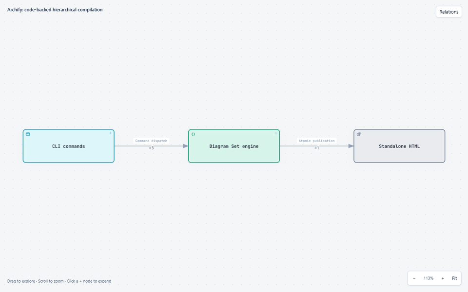

# Hierarchical drilldown implementation decisions

The Diagram Set is an opt-in, offline infinite canvas. The initial implementation
used separate foreground and parent panels; the requested interaction now
supersedes that prototype with proportional, in-place expansion. The recorded
comparison base is `58ab0b9`. Native schemas and authored geometry remain
authoritative; ordinary single-diagram pages are unchanged.

## Canvas decisions

- Reuse all five native renderers in sandboxed `srcdoc` iframes. This is a scene
  placement/camera change, not another SVG renderer.
- Store identical complete script/style blocks once per bundle, including
  embedded fonts, translations and the Bridge. Native documents contain ordered
  resource references and are restored byte-for-byte on lazy mount before
  injecting fresh instance credentials. Do not introduce remote dependencies or
  cross-origin resource workarounds. Opened iframes still execute independently.
- Put the main graph and every opened sibling/nested child in one world.
  Child bounds uniformly fit their original entrance node rectangle; opening
  a child magnifies the shared camera by the inverse placement scale, capped
  by available viewport fit. Parent nodes never undergo automatic relayout.
- Initialize embedded native scenes on demand. Park loading iframes in the
  viewport by countering the current camera so offscreen animation-frame
  throttling cannot stall native initialization. Keep each iframe under the
  same DOM parent; reparenting can reload its document and revoke credentials.
- Pan, pointer-anchored zoom, touch pinch, Fit and keyboard controls operate on
  the same camera. Open siblings stay mounted; collapse removes only the
  selected entrance and its descendants. Ancestors and children remain sharp
  and fully opaque, both on screen and in composed exports. Legacy frosting
  options remain accepted but have no visual effect.
- Add entrance badges only after fonts and native layout settle. Early hidden
  SVGs can report empty bounds, placing a badge at the SVG origin and inflating
  its node group's rectangle. Canvas targets, expansion slots and bridge
  endpoints use the native card mask, excluding decorative group bounds.
- Project facts through the complete open-entrance forest, not just the focused
  hierarchy. Each endpoint has one deepest exposed representative. Counts and
  source IDs survive one-to-one, one-to-many and many-to-many transitions.
  Unchanged native relationships keep their authored routes without duplicate
  flashing curves. Unknown endpoints stay at an explicit boundary.
- Hide both standalone Viewer and old Host toolbars in canvas mode. The optional
  Relations inspector occupies a separate desktop column or mobile bottom row,
  never overlays components. Coarse groups contain exposed branches and facts;
  IDs, evidence and mappings are progressively disclosed.
- Retain document-bound reply credentials, opaque sandbox origins and validated
  message sources. Host history stores the open forest, focused path and camera;
  child hash state remains private. Legacy path-only deep links still work.
- Keep clean current-diagram SVG/PNG and composed canvas PNG available through
  the Host API without reinstating unwanted toolbar controls. Composed snapshots
  preserve hidden entrance nodes/incident edges and omit native grid/legends.
  Editable combined SVG is deliberately unsupported.

## Reproducible example and acceptance

Open [`output.html`](../examples/diagram-set/output.html). This mirrors packaged
`archify/examples/diagram-set/canvas.html`, compiled from `canvas.json`.
The fictional authored example connects two frontend clients to two backend
endpoints with four stable HTTPS facts. Open Backend for two groups, then
Web Frontend for four distinct endpoint pairs. Pan or Fit to reach the other
entrance; opening Gateway adds nested authentication in the same world.
Collapse either side to refold those facts. No code-verification claim is made
by this fixture.

The maintained browser suite exercises real offline `file://`, actual mouse
drag/wheel, proportional placement, sibling and nested expansion, endpoint
alignment, refolding, history/refresh/invalid paths, docked/mobile inspector,
search, touch pinch, keyboard, reduced motion, source counts, all five native
types, exports, forged-message rejection and unexpected iframe navigation.
`ARCHIFY_DIAGRAM_SET_EVIDENCE` captures the representative visual states and
`benchmark.json`. Screenshot inspection is separate from coordinate assertions;
there is no FPS, cross-browser or hardware performance guarantee.

Only opened scenes are live, at most the manifest's 32 diagrams. Same-endpoint
bundles remain collapsed unless explicitly separated; selecting one fact draws
it plus the remainder. The view cache is bounded to 64 projections. Native
compiler caching remains opt-in and authenticated; repository evidence bypasses
native reuse. Typed correspondence is explicit and direction-checked.
Fact endpoints morph for 220 ms and the camera eases for 260 ms; reduced motion
makes both immediate.

At the initial shared-resource packing checkpoint, the five-type example fell from 4,090,069 to
1,107,151 bytes (72.9%) and the four-diagram canvas example from 3,214,798 to
977,750 bytes (69.6%). Packing reconstructed every native page byte-for-byte;
the same invariant remains covered as the Viewer evolves. These are fixture measurements, not a
claim that separate iframes share execution memory. Regressions require the
five-type HTML to stay below 1.2 MiB and its serialized payload to be at least
65% smaller than storing the reconstructed documents independently.

The measured toolchain is official Node 22.23.2 and HeadlessChrome
155.0.8059.39 on Windows x64. The current 100-node/191-native-edge/300-fact
fixture keeps three scenes and 31 fact paths (30 distinct endpoints plus one
selected fact), counting all 300 source IDs once with endpoint error below
one CSS pixel. Compile and navigation/check timings are recorded by each run in
`benchmark.json`; explicit settling and screenshot time are included, so these
are not pure navigation-latency measurements.

The [earlier drilldown recording](assets/archify-drilldown.gif) is historical:
it shows the superseded foreground-panel interaction, not the current canvas.

## Three-phase completion evidence

The remaining implementation now includes byte/range/full-commit source
snapshots, drift warnings rechecked on every compile, bounded exact directed
chains, trace/hop navigation and native highlighting, stateful sharing,
obstacle-aware Host routing, caption avoidance, quality diagnostics and
viewport work limits. The schema, generated validator, Skill and
[three authoring recipes](../archify/references/diagram-set-recipes.md) describe
the same contract. The [original checklist](../Archify_Hierarchical_Drilldown_Implementation_Plan.md)
distinguishes completed work from later UX decisions that supersede its wording.

The [real repository example](../archify/examples/diagram-set/repository/README.md)
uses four diagrams and three layers for Archify's actual CLI/compiler/native
dispatch. All 13 facts have source snapshots, and three named chains join exact
canonical endpoints. The 1-to-3 command dispatch and 1-to-5 type choices are
conditional alternatives, not simultaneous runtime calls. The local
`evidence-receipt.json` audits current source bytes; the standalone HTML is
deliberately portable and reports unverified sources without the checkout.
Matching bytes does not prove an author's semantic interpretation.

### Current recording and visual inspection



[`archify-canvas.json`](assets/archify-canvas.json) records the input/artifact
digests, browser/version, continuous capture method, real frame count/duration,
state transitions and scoped quality results. This is a continuous real-browser
capture, not animation synthesized from a few selected screenshots. The current
run samples 77 real frames over about 14.7 seconds; FFmpeg's verified GIF is
960x600, 119 decoded frames, 14.88 seconds. Original viewport: 1280x800.
It opens command and engine details, unfolds the five native type endpoints,
steps through three directed hops, pans/zooms and refolds the same facts.

The five [key captures](assets/drilldown-canvas/) show root, one-to-many,
third-layer detail, traced hop and refolded root. Inspection confirms proportional
placement, sharp ancestors, distinct directed endpoints and a docked inspector
outside the canvas. Native Focus may emphasize/dim other nodes in the current
child; no ancestor blur or global dimming is applied.

To reproduce from the repository root with Chrome and FFmpeg/ffprobe available:

```sh
node scripts/build-drilldown-repo-example.mjs
ARCHIFY_CHROME="/path/to/chrome" node scripts/record-drilldown.mjs docs/assets/archify-canvas.gif
```

Recording receipts contain environment-specific timings, not a deterministic
media artifact or an FPS guarantee. The deterministic package contains source
JSON and offline HTML, not this repository-only recording.

### Performance and iframe decision

The [benchmark receipt](assets/drilldown-canvas/benchmark.json) uses Windows x64,
Intel Core i7-10700 at 2.90 GHz, 16 logical cores and 32 GiB RAM, official
Node 22.23.2 and HeadlessChrome 155.0.8059.39. Its 100-node/191-native-edge/
300-fact run measured 2209 ms compilation and 1928 ms navigation plus checks,
with three live scenes, 31 paths and all 300 IDs counted once. Those timings
include settling/check work and are not pure input latency or a threshold
promised on other hardware.

Keep iframe reuse for this scope. Native execution contexts are isolated and
only opened diagrams are mounted (maximum 32). Shared resources deduplicate
HTML transmission bytes, not iframe JavaScript execution or RAM. Host route
cache is limited to 256 entries, view cache to 64, and each settled draw paints
up to 256 visible canonical groups with explicit deferred-group diagnostics.
Offscreen targets are virtualized and scene geometry watching pauses; browser
viewport clipping handles offscreen paint. Do **not** toggle a live iframe's
CSS visibility: the real teardown regression stalled Chromium after inspecting
an offscreen child. Leaving paint clipping to the browser preserves clean
collapse, native focus and execution-context identity across suspension.

The final five-type HTML remains below the 1.2 MiB budget; serialized resource
packing still saves at least 65%, and restores native documents byte-for-byte.
Those budgets are enforced by the model and extracted-package checks, not a
claim that context memory is shared. Larger datasets may justify a single-scene
native runtime later; no unsupported replacement is included here.

### Acceptance scope

The maintained tests cover actual `file://`, all five native types, deep
navigation, sibling many-to-many facts, chain steps, source state display,
shared camera/filter/trace restoration, invalid links, keyboard search and
fullscreen, suspension/re-entry and clean current/composite exports.
Native renderer golden inputs remain unchanged. Gallery artifacts and the
single-diagram template are intentionally unchanged because their authoritative
inputs did not change; the affected Diagram Set HTML and root canvas mirror
were rebuilt.

Windows HeadlessChrome 155 and Linux Chromium 154 acceptance are recorded
separately. Neither establishes Safari/Firefox, macOS or installed Edge
acceptance. Edge's headless launcher could not establish this CDP pipe on this
host, so no Edge browser pass is claimed. Full-suite/platform results and
extracted-package evidence remain separate from focused Diagram Set acceptance;
a skipped or blocked check is not passed.

Final Windows focused command, from the repository root (official Node 22.23.2,
`ARCHIFY_CHROME` set, task-owned temporary directory, no concurrent broad suite):

```sh
node --test --test-concurrency=1 archify/test/diagram-set.test.mjs archify/test/diagram-set-completion.test.mjs archify/test/diagram-set-browser.test.mjs archify/test/offline-self-containment.test.mjs archify/test/path-boundary-contract.test.mjs
```

**Passed: 102 tests, 0 failures, 0 skips.** This includes 24 real-browser
tests, 18 completion/source/authoring tests, the existing 48 model tests,
six offline/font tests and six physical-path boundary checks.
`node scripts/generate-viewer.mjs --check` and
`node archify/scripts/generate-validators.mjs --check` passed. The earlier
combined model/completion/Viewer-generator check passed 342 tests; final
LF-normalized output was checked again by the focused command and freshness
checks, not relabeled as another 342-test run.

The cross-platform acceptance follow-up fixes the test transport rather than
disabling site isolation. CDP event subscriptions attach to out-of-process
sandboxed iframes, install observers before resuming them, and preserve native
frame/context identity through suspension. Offline checks reconstruct every
pooled native document before checking its fonts, license and subresources;
missing fonts, remote resources and invalid pool references still fail.
The repository example's entry guard uses the shared physical `sameEntry`
helper instead of path-string equality. The VM transport fixture supplies the
same EventEmitter dependency and confirms that subscribers and one-shot
waiters both receive events while the 15000 ms timeout remains unchanged.
`node --test archify/test/joint-layout-contract.test.mjs` passed all 16 tests.

Single-diagram compatibility was separately run from the repository root:

```sh
node --test --test-concurrency=1 archify/test/viewer-camera-browser.test.mjs archify/test/export-cleanup-browser.test.mjs archify/test/export-browser.test.mjs archify/test/focus-browser.test.mjs archify/test/finder-browser.test.mjs archify/test/desktop-reader-browser.test.mjs archify/test/offline-font-browser.test.mjs
```

**Passed: 64 tests, 0 failures, 0 skips.** This is the actual Chrome
camera, native Focus/Finder, export, desktop-reader and offline-font coverage,
not a claim that every unrelated suite passed.

The tracked-only frozen-source package was built through a **temporary index**
with all new Skill files included; the real index was not staged. Official
Node 22.23.2/zlib `1.3.1-e00f703` produced two byte-identical archives.
`node scripts/package-smoke.mjs <extracted-package>/archify` passed outside the
repository on Windows and Linux, including zero installed dependencies, current/dense/
five-type/many-to-many HTML and the portable real-code/chain example.
The final `archify.zip` SHA-256 is
`81ef0b1675f42d679d4eb7fa2ed8fe6953cac88b35cc67594e2c636fa05fa57f`.
This is a local repository distribution refresh, not a published release or
update to any live installation.

**Broad local acceptance passed on isolated Linux.** The final candidate was
frozen through a temporary index, copied onto the container's native Linux
filesystem and tested with official Node 22.23.2/zlib `1.3.1-e00f703` and
Debian Chromium 154.0.8037.92. The base image is
`node:22.23.2-bookworm@sha256:dd5847a04b0deee391fa145f1f4c6d214196668b6bcc7988ebed67249f226844`.
Dependencies were reused from the existing checkout; browser/media tools were
installed only after the required browser gate reported a missing executable.
Host source/index and live installations were not modified by container setup.

Commands from `archify/`, with `ARCHIFY_CHROME=/usr/bin/chromium`:

```sh
npm test
npm run test:browser
npm run test:webm
```

`npm test` passed freshness/identity checks and all native golden renders,
then completed **2638 tests: 2619 passed, 0 failed, 19 skipped**. The skips
are explicit platform/capability gates, not passes. The separate required
`test:browser` gate completed **296 tests: 296 passed, 0 failed, 0 skipped**.
`test:webm` passed real artifact decoding and all seven site-language integration
tests, without failures or skips.
The 51 atomic/recovery/staging/Cloudflare/Cursor cases that had blocked the
Windows investigation also passed on Linux without skips. A final scoped Linux
run of Diagram Set browser, offline/font and physical-path checks passed all
36 tests without skips.

The [machine-readable acceptance receipt](assets/drilldown-canvas/acceptance.json)
pins tested candidate tree `ed9b17df55860e8d4472be8c3e6d6d74d332f495` and
Skill/runtime/test subtree `d1ae55aaa1daad575277e5973a5cadb6ff38606b`.
Only repository-only acceptance documentation, checklist and that receipt were
updated after the run. The Linux builder produced two byte-identical archives
matching the repository ZIP; extracted-package smoke passed on both Linux and
Windows.

The earlier Windows-wide `npm test` was failing and interrupted after more
than 680 top-level cases; it is not relabeled as a complete or passing run.
With correct Git Bash/unzip paths and no parallel build, a serial Windows
51-case reproduction still had 13 atomic/recovery/staging failures and eight
POSIX-only skips. Its metadata and syscall observations are environment-specific;
the publication and source-binding guards were not weakened or given silent
retries. Final Windows evidence is the 102 focused checks, 64 native browser
checks and refreshed extracted-package smoke above. Complete Windows/macOS
suite acceptance and required remote CI remain unclaimed; local completion
does not authorize a release, PR publication or installation.

Shared-child DAGs, automatic parent relayout and unconditional cross-type
equivalence are outside this delivery. The canonical
[Diagram Set contract](../archify/references/diagram-sets.md) owns authoring,
commands, limits, supported semantics and export boundaries.
